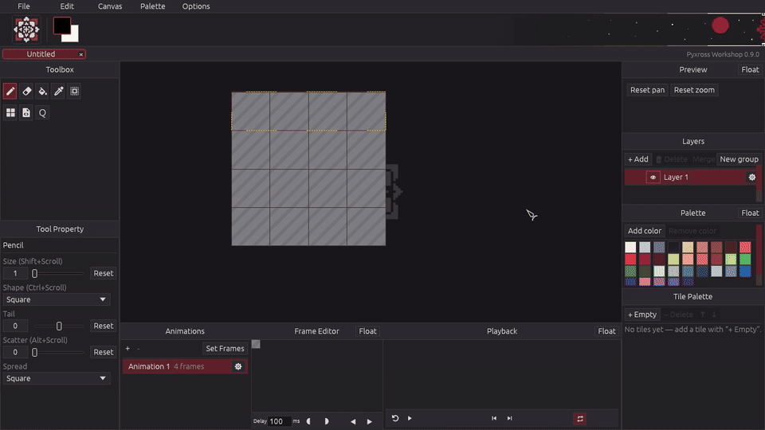
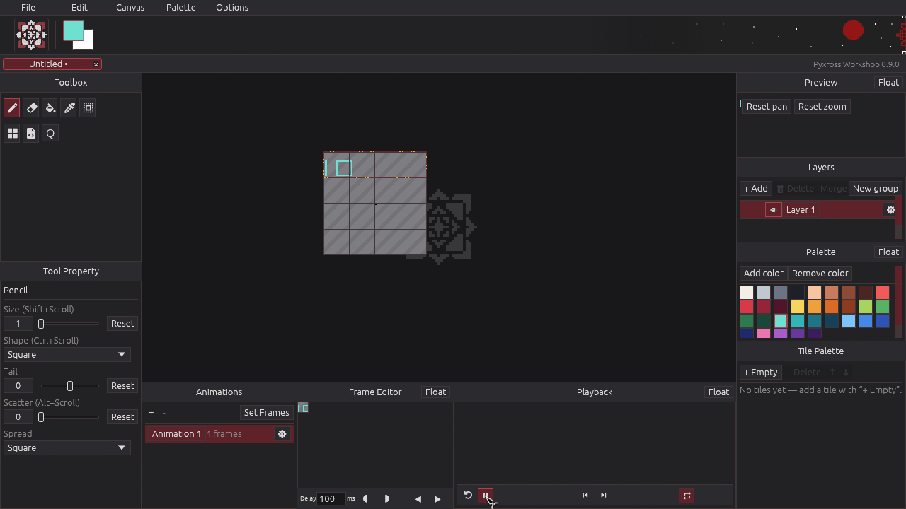

<div align="center">
  

  <h1>Pyxross Workshop</h1>

  <p>
    <b>A 100% free, open-source, region-based pixel art editor built for creating game assets.</b>
  </p>

  <p>
    <a href="https://github.com/KirbajiFidnan/Pyxross/releases"></a>
    <a href="https://github.com/KirbajiFidnan/Pyxross/actions/workflows/ci.yml"></a>
    <a href="LICENSE"></a>
    
    
  </p>

  <p>
    <a href="#-download--install">Download</a> •
    <a href="#-why-pyxross">Why Pyxross?</a> •
    <a href="#-features">Features</a> •
    <a href="#-building-from-source">Build from Source</a> •
    <a href="#-credits--thank-you">Credits</a>
  </p>
</div>

<p align="center">
  
</p>

> [!NOTE]
> **Early-Stage Project Notice:** Pyxross Workshop is a brand-new, actively developed project (**v0.9.0**). Because it is still fresh and has not yet been exhaustively tested across every OS, Linux desktop environment, and GPU driver combination, **bugs or unexpected crashes may occur**. Save often, and please [open a bug report](https://github.com/KirbajiFidnan/Pyxross/issues/new?template=bug_report.yml) if you run into anything — every report helps make Pyxross more stable!

---

## 🎯 Why Pyxross?

**Pyxross Workshop** is a **100% free and open-source** (MIT-licensed) desktop pixel art editor written in native Rust (`winit` + `wgpu` + `egui`), designed from the ground up as a **practical, lightweight, free alternative** for indie game developers and pixel artists.

Instead of treating animations, tilesets, and sprites as disconnected files, Pyxross focuses directly on **game asset production**:

- **One Canvas, Many Game Assets:** Lay out your entire tileset, character sprite sheet, and animation strips on a single region-based canvas.
- **Regions as First-Class Units:** Define rectangular grid cells that become linked tiles and animation frames — edit once, preview live, and export cleanly for your game engine.
- **No Paywalls, No Accounts, No Telemetry:** Completely free, portable, and open source forever.

---

## ✨ Features

### 🎮 Game Asset & Region Workflow
- **Region Grid & Tilemap System:** Create tile grids (`16×16`, `32×32`, or custom), place linked tile instances with flip/rotate transforms, and edit tiles in place.
- **Animation Suite:** Multiple named animations per canvas, live **Playback** preview, dedicated **Frame Editor** with onion skinning, per-frame delays, and speed multipliers.
- **Layers & Groups:** Hierarchical layer groups, opacity, visibility, locking, and full undo/redo history.

### 🖌️ Drawing & Pixel-Perfect Transforms
- **Pixel Tools:** Pencil, Eraser, Fill, Eyedropper, Rectangle / Wand / Lasso selection, Tile Placer, Animation Placer, and Text tool.
- **Structure-Preserving Rotation:** Free rotation and scaling powered by **RotSprite**, **CleanEdge**, and **Rotxel**, alongside exact 90°/180°/270° and flip operations.
- **Image-to-Pixel Pipeline:** Convert reference photos or high-res art directly into crisp pixel art with sampling, K-means palette extraction, and dithering.

### 📦 Formats & Interoperability
- **Native `.pyxross` Archive:** Single-file ZIP project format (plus directory projects) with autosave and crash recovery.
- **Aseprite (`.ase` / `.aseprite`):** Import and export layers, groups, tags, and animation frames.
- **Pyxel Edit (`.pyxel`):** Import and export tiles, tilemaps, layers, and palettes.
- **Engine-Ready Exports:** Export sprite sheets (PNG + metadata), animated **GIFs**, and selected regions.

### 🖥️ Native, Portable & Customizable
- **Fast Native Rust Stack:** Hardware-accelerated GPU rendering (`wgpu`) with automatic software fallback (`WARP` on Windows, `llvmpipe`/`lavapipe` on Linux).
- **Dockable Workspace:** Rearrange, float, and customize panels, UI themes, pixel-art top-bar banners, and remappable keybindings.
- **Built-in Cross-Platform File Manager:** Works out of the box across Windows (drive letters) and Linux desktop environments (reads GTK and KDE Dolphin bookmarks) without external portal hangs.

<p align="center">
  
</p>

---

## 📥 Download & Install

Grab the latest prebuilt binaries from the **[GitHub Releases](https://github.com/KirbajiFidnan/Pyxross/releases)** page.

### 🐧 Linux (`x86_64`)
Built on an **Ubuntu 22.04 LTS (`GLIBC 2.35`)** baseline for broad compatibility across Ubuntu 22.04+, Debian 12+, Linux Mint 21+, Pop!_OS, Fedora, openSUSE, SteamOS, and Arch Linux (native **Wayland** and **X11**).

- **AppImage (recommended, single file):**
  ```sh
  chmod +x pyxross-0.9.0-linux-x86_64.AppImage
  ./pyxross-0.9.0-linux-x86_64.AppImage
  ```
- **Portable Archive (`.tar.gz`):**
  ```sh
  tar -xzf pyxross-0.9.0-linux-x86_64.tar.gz
  cd pyxross-0.9.0-linux-x86_64
  ./pyxross
  ```
- **Verify Checksums:**
  ```sh
  sha256sum -c SHA256SUMS
  ```

> **Linux DE Note (GNOME Wayland):** GNOME Mutter does not implement `wlr-data-control`. In-app copy/paste works normally, while OS-level image copy/paste with external apps on GNOME Wayland may fall back to the internal clipboard.

### 🪟 Windows (`x86_64`, Windows 10 / 11)
1. Download `pyxross-0.9.0-windows-x86_64-portable.zip` from **[Releases](https://github.com/KirbajiFidnan/Pyxross/releases)**.
2. Extract the archive to any folder (keep `themes/` and `banners/` alongside `pyxross.exe`).
3. Run `pyxross.exe` — no installer required.

---

## 🛠️ Building from Source

Requires **Rust 1.95+** (`rust-version = "1.95"`).

```sh
git clone https://github.com/KirbajiFidnan/Pyxross.git
cd Pyxross
cargo build --release
./target/release/pyxross
```

<details>
<summary>Linux build dependencies (Debian / Ubuntu) & Packaging scripts</summary>

```sh
sudo apt-get install -y build-essential pkg-config \
  libwayland-dev libx11-dev libxcb1-dev libxcb-render0-dev \
  libxcb-shape0-dev libxcb-xfixes0-dev libxkbcommon-dev
```

- **Portable Linux (`GLIBC 2.35`, via Docker):** `./scripts/package-linux-portable.sh`
- **Native Linux:** `SOURCE_DATE_EPOCH=$(date +%s) ./scripts/package-linux.sh`
- **Native Windows (PowerShell):** `$env:SOURCE_DATE_EPOCH = '1735689600'; .\scripts\package-windows.ps1`

</details>

---

## 🤝 Contributing & Feedback

This is an independent open-source project and community feedback is huge!
- Found a bug or crash? [Report an Issue](https://github.com/KirbajiFidnan/Pyxross/issues/new?template=bug_report.yml)
- Have an idea for game-asset workflows? [Request a Feature](https://github.com/KirbajiFidnan/Pyxross/issues/new?template=feature_request.yml)
- Want to contribute code or themes? See [CONTRIBUTING.md](CONTRIBUTING.md) and [CHANGELOG.md](CHANGELOG.md).

---

## 💖 Credits & Thank You

Pyxross Workshop would not exist without the incredible open-source community and the creators who generously shared their code, algorithms, and ideas. A heartfelt **thank you** to everyone behind these projects:

| Project / Author | License | How It Helped Pyxross |
|---|---|---|
| **[SLK_img2pixel](https://github.com/Captain4LK/SLK_img2pixel)** — Lukas Holzbeierlein (Captain4LK) | CC0-1.0 | Direct inspiration and algorithmic foundation for the Image-to-Pixel pipeline (sampling, K-means palette extraction, and dithering) |
| **Pyxel Edit** & **Aseprite** | — | Core workflow inspirations for region-based tilesets, sprite sheets, layers, and pixel-perfect rotation |
| **[egui](https://github.com/emilk/egui) & [egui_dock](https://github.com/Adanos020/egui_dock)** — Emil Ernerfeldt & contributors | MIT / Apache-2.0 | Immediate-mode GUI framework and dockable workspace |
| **[wgpu](https://github.com/gfx-rs/wgpu) & [winit](https://github.com/rust-windowing/winit)** — gfx-rs & rust-windowing | MIT / Apache-2.0 | Cross-platform GPU rendering and native Wayland/X11/Windows windowing |
| **[image](https://github.com/image-rs/image), [png](https://github.com/image-rs/image-png), [gif](https://github.com/image-rs/image-gif), [arboard](https://github.com/1Password/arboard), [serde](https://github.com/serde-rs/serde), [flate2](https://github.com/rust-lang/flate2), [ab_glyph](https://github.com/alexheretic/ab-glyph), [dirs](https://github.com/dirs-dev/dirs-rs)** | MIT / Apache-2.0 | Image codecs, clipboard integration, font rasterization, serialization, and compression |
| **[JetBrains Mono Nerd Font](https://www.nerdfonts.com/)** — JetBrains s.r.o. & Nerd Fonts | [SIL OFL 1.1](assets/fonts/OFL.txt) | Embedded crisp UI and tool icon glyphs |

---

## 📜 License

**Pyxross Workshop** is created by **Hacı Can "Kuzg" Güngör** and distributed under the **[MIT License](LICENSE)**.
The embedded JetBrains Mono Nerd Font is licensed under the **[SIL Open Font License 1.1](assets/fonts/OFL.txt)**.
