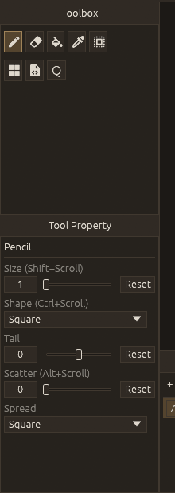

# 2. Toolbox, Tool Properties & All Tools

> **In this chapter:** Detailed guide to the **Toolbox**, how the **Tool Property** panel adapts to your active tool (or active transform), and how every single tool works with its shortcuts and modifier keys.

---

## How the Toolbox & Tool Property Panels Work

  

- The **Toolbox** (top-left) displays all 8 tools as compact icon buttons. Hover any button to see its name and current keyboard shortcut.
- The **Tool Property** panel (bottom-left) automatically updates to show the controls for your active tool.
- When you have an active **Transform** (a lifted selection being rotated or scaled), Tool Property temporarily switches to the **Transform** header so you can pick the rotation algorithm (**RotSprite**, **CleanEdge**, or **Rotxel**).

> [!TIP]
> **Pencil** and **Eraser** each remember their own independent Size, Shape, Tail, Scatter, and Spread settings — switching between them never overwrites the other's brush setup.

---

## Tool-by-Tool Reference

### 1. Pencil (`D`)
Paints opaque or translucent pixels onto the active layer using the Foreground color.

- **Single Click:** Stamps one brush footprint immediately.
- **Drag:** Draws continuous pixel-perfect strokes.
- **Straight Line Mode (`Shift` + Drag):** Hold `Shift` before dragging to preview and commit a crisp straight pixel line.
- **Line-to-Transform (`Alt` + `Shift` + Drag):** Releases the line as a movable/rotatable transform object.
- **Quick Brush Adjustments (over canvas):**
  - **`Shift` + Mouse Wheel:** Adjust **Size**
  - **`Ctrl` + Mouse Wheel:** Cycle **Shape** (`Square` / `Round`)
  - **`Alt` + Mouse Wheel:** Adjust **Scatter**

**Tool Property Controls:**
| Control | Description |
|---|---|
| **Size (`Shift+Scroll`)** | Brush diameter in pixels (`1` up to max brush size) + `Reset` button |
| **Shape (`Ctrl+Scroll`)** | Brush stamp geometry: `Square` or `Round` |
| **Tail** | Bipolar stroke taper (`-100` to `+100`): tapers the start or end of strokes and lines |
| **Scatter (`Alt+Scroll`)** | Random stamp spread radius (`0`–`32`) for texture, foliage, dithering, and noise |
| **Spread** | Distribution shape for scatter (`Square`, `Circle`, `Diamond`) |

---

### 2. Eraser (`E`)
Removes pixels back to full transparency (`alpha = 0`) on the active layer.

- Supports the exact same **Size**, **Shape**, **Tail**, **Scatter**, **Spread**, and **`Shift` Straight Line** controls as Pencil, stored independently.

---

### 3. Fill / Paint Bucket (`F`)
Fills an area with the current Foreground color.

- **Click** any pixel to flood-fill all connected pixels of the same color within the active layer (respecting any active selection mask).
- Works cleanly with undo/redo as a single atomic command.

---

### 4. Eyedropper (Right-Click)
Samples the visible color under the cursor and sets it as the active Foreground color.

- **From any drawing tool:** Simply **Right-Click** on the canvas to sample a color without switching tools.
- You can also select the Eyedropper explicitly in the Toolbox and Left-Click to sample.

---

### 5. Selection Tool / Fieldier (`S` / `W` / `L`)
Selects pixels on the canvas for copying, cutting, deleting, moving, flipping, rotating, or exporting.

The Selection tool has **3 sub-modes (Children)** selectable via shortcut or the **Child** dropdown in Tool Property:

#### A. Rectangle Select (`S`)
- **Drag:** Draws a rectangular marquee selection.
- **Double-Click a Region:** Instantly selects that entire grid cell/region! (`Shift` + Double-Click adds that region to your selection.)
- **Modifiers:**
  - **`Shift` + Drag:** Add to current selection.
  - **Right-Drag:** Subtract from current selection.

#### B. Magic Wand (`W`)
Selects pixels matching the clicked pixel's color.
- **Contiguous (`Alt`):** When enabled, selects only connected pixels; hold **`Alt`** while clicking to temporarily select **all matching pixels** across the layer (non-contiguous).
- **Tolerance (`0`–`255`):** Controls how closely neighboring colors must match the clicked pixel.
- **Restrict to region:** Confines the wand fill strictly inside the clicked grid cell/region — ideal for isolating a single sprite frame!
- **Modifiers:** `Shift` adds to selection; Right-Click subtracts.

#### C. Lasso (`L`)
- **Drag:** Draws a freehand polygon selection mask.
- **Double-Click outside:** Dismisses the active selection.

#### Working With an Active Selection
- **Move / Lift to Transform:** Drag inside the selection to lift pixels into a floating transform session.
- **Copy / Cut / Paste:** `Ctrl+C`, `Ctrl+X`, `Ctrl+V` (supports both in-app and OS image clipboard).
- **Delete:** `Delete` clears selected pixels.
- **Invert Selection:** `Ctrl+I`.
- **Flip / Rotate Selection:** `Ctrl+F` (Flip H), `Shift+F` (Flip V), `Alt+F` (Rotate 90°).

---

### 6. Tile Tool (`T`)
Places, transforms, samples, and erases linked tiles from the **Tile Palette** onto the region grid.

- **Left-Click / Drag:** Stamps the active tile into grid cells.
- **`Shift` + Drag:** Fills a rectangular block of grid cells with the active tile.
- **Right-Click / Drag:** Erases tiles from grid cells (and **`Shift` + Right-Drag** erases a rectangle).
- **Tile Eyedropper (`Alt` + Click):** Samples the tile under the cursor (showing a ghost tile preview).
- **Placement Transforms (while Tile Tool is active):**
  - **`X`:** Flip tile horizontally before placing
  - **`V`:** Flip tile vertically before placing
  - **`R` / `Shift+R`:** Rotate tile 90° CW / CCW before placing

See **[Chapter 5: Tile Palette & Linked Tiles](05-tiles.md)** for the full tile workflow.

---

### 7. Animation Placer (`A`)
Defines which grid regions belong to the active animation.

- **Click or Drag** across a rectangular range of grid cells on the canvas.
- On release, Pyxross indexes those cells in **row-major order** (left-to-right, top-to-bottom) as the frames of the currently selected animation.
- You can also activate it directly from the **Set Frames** button inside the **Animations** panel.

See **[Chapter 4: Animation System](04-animations.md)** for details.

---

### 8. Text Tool (`Q`)
Stamps crisp, pixel-aligned bitmap text directly onto the canvas.

- Click on the canvas to place a live text transform box and start typing.
- In **Tool Property**, choose:
  - **Font:** Pick from bundled or discovered system fonts.
  - **Size:** Pixel font size.
  - **Alignment:** Left, Center, or Right.
- Click outside the text box (or press Enter/commit) to bake the text onto the active layer as an undoable edit.

---

**Previous:** [← 1. Getting Started](01-getting-started.md) | **Next:** [3. Layers & Layer Groups →](03-layers.md)
