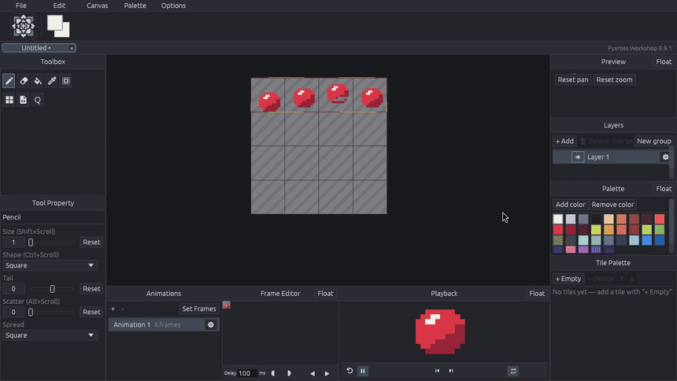

# 4. Animation System

> **In this chapter:** Multi-animation architecture, assigning frame regions with the Animation Placer, painting inside the Frame Editor with onion skinning, and controlling live playback.

---

## Multi-Animation Philosophy

In game development, a single character sprite sheet usually holds **multiple animations** side by side — for example:
- Row 1: `Idle` (4 frames)
- Row 2: `Walk` (6 frames)
- Row 3: `Attack` (4 frames)
- Row 4: `Jump` (2 frames)

Pyxross models this natively: **one document can hold any number of named animations**, and each animation is simply an ordered list of **Region** references on your canvas.

---

## The Three Animation Panels (Bottom Dock)

  

### 1. Animations Panel
Manages the list of animations in your document:
- **`+`:** Adds a new animation to the document.
- **`-`:** Removes the selected animation (at least one animation is always kept).
- **`Set Frames`:** Activates the **Animation Placer (`A`)** tool so you can drag over canvas regions to define frames for the active animation.
- **Animation Row:** Displays the animation's name and frame count (e.g., `Animation 1 · 4 frames`). Click a row to switch the active animation.
- **Settings (Gear icon):** Opens **Animation Settings** where you can:
  - Rename the animation (e.g., `Idle`, `Walk`, `Attack`)
  - Adjust the **Delay Multiplier** (speeds up or slows down the entire animation proportionally, e.g., `0.5x` or `2.0x`)
  - Toggle **Looping**

### 2. Frame Editor Panel
A dedicated, focused viewport locked to **one frame at a time** — so you can draw frame-by-frame without getting lost on a large sprite sheet!

- **Direct Painting:** Paint, erase, fill, and undo directly inside the Frame Editor; your strokes automatically write to the exact canvas coordinates of that frame's region on the active layer!
- **Independent Cursor:** The Frame Editor's frame cursor is independent of the Playback panel, so you can edit Frame 2 while watching the full loop play in Playback.
- **Frame Delay (`Delay ___ ms`):** Set the exact duration (in milliseconds, default `100 ms`) for the currently edited frame.
- **Onion Skinning (Previous / Next toggles):**
  - **Prev Onion:** Overlays a translucent ghost of the previous frame (wraps around to the last frame when on Frame 0).
  - **Next Onion:** Overlays a translucent ghost of the next frame (wraps around to Frame 0 when on the last frame).
- **Previous / Next Frame Arrows:** Step cleanly through frames with automatic wrap-around.

### 3. Playback Panel
Displays a clean, real-time animated preview of the active animation:
- **Play / Pause:** Start or stop live animation playback.
- **Restart / Step Prev / Step Next:** Jump to the start or inspect individual frames.
- **Loop Toggle:** Continuously repeat the animation or stop at the final frame.
- **Float:** Click **Float** to detach Playback into a floating window anywhere over your workspace.

---

## Typical Game Animation Workflow

1. Create a document sized for your sprite sheet (e.g., `16×16` regions, `6 cols × 4 rows`).
2. Select `Animation 1`, open its gear settings, and rename it to `Idle`.
3. Click **Set Frames** (or press **`A`**) and drag across the first 4 cells of Row 1.
4. Draw Frame 1 directly on the main canvas or inside **Frame Editor**.
5. Step to Frame 2 in **Frame Editor**, turn on **Previous Onion Skin**, and draw your next pose using the ghost guide.
6. Press **Play** in the **Playback** panel to watch the animation loop live as you refine pixels!
7. Click **`+`** in **Animations** to add `Walk`, press **`A`**, and drag across Row 2 to start your next animation on the same sheet.
8. When ready, export via **File → Export Animation** (`Ctrl+Shift+A`) as a **Sprite Sheet** or **Animated GIF**.

---

**Previous:** [← 3. Layers & Layer Groups](03-layers.md) | **Next:** [5. Tile Palette & Linked Tiles →](05-tiles.md)
