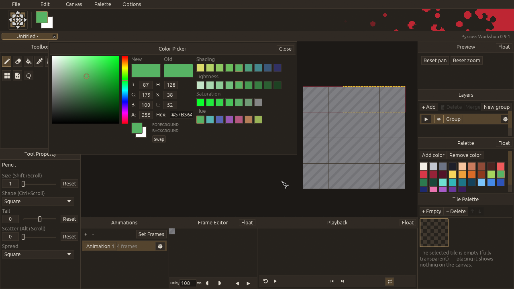

# 6. Colors, Palettes & Color Picker

> **In this chapter:** Working with Foreground/Background colors, managing palettes, loading built-in palettes, and using the Color Picker's shading and lightness ramps.

---

## Foreground & Background Colors

At the top-left of the Top Bar (next to the New Document flower emblem), you will see two overlapping color squares:
- **Foreground (FG — front square):** The primary color used by Pencil, Fill, and Text. Click it to open/toggle the **Color Picker**.
- **Background (BG — back square):** Your secondary/alternate color. Click it (or press **`X`** outside the Tile Tool) to instantly swap Foreground and Background colors.

---

## The Palette Panel

Located in the right dock, the **Palette** panel gives you one-click access to your project's color swatches:

- **Left-Click a Swatch:** Sets it as your active **Foreground** color.
- **`Add color`:** Adds the current Foreground color to your active palette.
- **`Remove color`:** Removes the selected swatch from the palette.

### Built-in & Custom Palettes (`Palette` Top Menu)
Open the **Palette** menu in the Top Bar to switch between built-in pixel art palettes (such as **DB16** and **PICO-8**) or load custom JSON palettes placed in:
- `<config_dir>/pyxross/palettes/` (Linux: `~/.config/pyxross/palettes/`, Windows: `%APPDATA%\pyxross\palettes\`)

---

## The Color Picker (`C`)

  

Press **`C`** (or click the Foreground swatch in the Top Bar) to open the floating **Color Picker** panel.

It is designed specifically for pixel-art color selection and hue-shifting:

1. **SV Square & Hue Bar:** Pick exact Saturation, Value, and Hue interactively.
2. **FG / BG Swatches & Swap:** Compare your **Old** vs **New** color and swap FG/BG directly inside the picker.
3. **Numeric Inputs:** Fine-tune exact **R, G, B, A** and **H, S, L** values (or Hex).
4. **Pixel-Art Variation Chips (4 Rows):**
   - **Shading Row (9 chips):** Automatic **hue-shifted** ramp centered on your active color — brighter steps shift warmer (toward yellow) and darker steps shift cooler/deeper, making natural pixel-art shading effortless!
   - **Lightness Row (9 chips):** Evenly spaced lightness steps from bright to dark without shifting hue.
   - **Hue & Saturation Rows (7 chips each):** Quickly explore neighboring hues and muted/vibrant tones.

Click any variation chip to jump straight to that color!

> [!TIP]
> You can also extract a clean limited palette from any reference photo using **File → Import Image 2 Pixel** (`Ctrl+Alt+X`) — see [Chapter 7](07-files-import-export.md).

---

**Previous:** [← 5. Tile Palette & Linked Tiles](05-tiles.md) | **Next:** [7. Files, Import & Export →](07-files-import-export.md)
