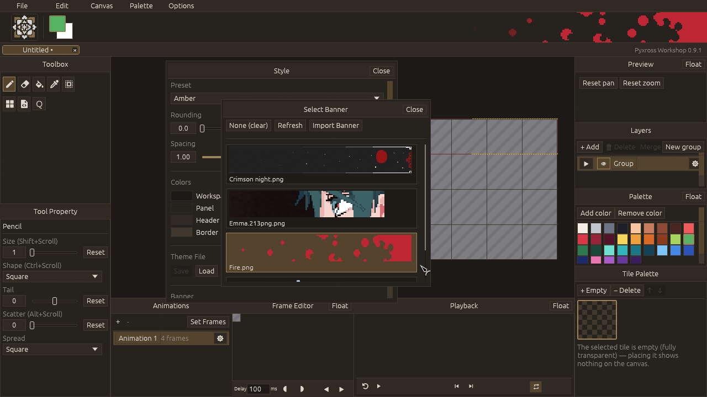
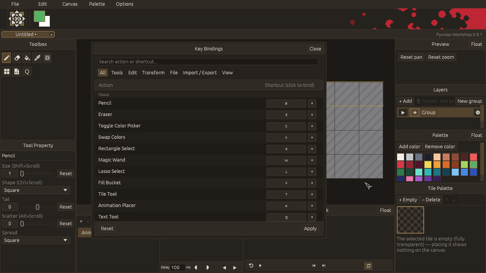

# 8. Style & Interface Customization

> **In this chapter:** Rearranging dockable/floating panels, customizing UI Style, installing custom themes, choosing top-bar pixel-art banners, remapping keybindings, and tuning Editor Options.

---

## Dockable & Floating Panels

Pyxross's workspace is built on a flexible dock system:
- **Resize Docks:** Drag the divider edge between the left, right, or bottom dock and the canvas.
- **Float a Panel:** Click **Float** in a panel's header (e.g., Preview, Layers, Palette, Tile Palette, Frame Editor, Playback) to detach it into a movable, resizable floating window.
- **Workspace Persistence:** Your panel layout is saved automatically when you close Pyxross (`workspace.json` in your config folder) and restored on next launch.

---

## UI Style (`Options → Style`)

  

Open the floating **Style** panel from the **Options** menu to customize the look and feel of the interface (persisted in `style.json`):
- Adjust corner rounding, spacing, and visual chrome preferences.
- Changes apply live across every panel and modal without restarting.

---

## Custom Themes

Every chrome color in Pyxross comes from the **Theme System** — no hard-coded UI colors.

### Where Pyxross Searches for Themes (Priority Order)
1. Directory specified by the **`PYXROSS_THEMES`** environment variable (if set).
2. `<exe_dir>/themes/user/` and `<exe_dir>/themes/builtin/` (next to the binary).
3. `./themes/user/` and `./themes/builtin/` (current working directory).

### Creating Your Own Theme
1. Copy `themes/builtin/theme.json` into `themes/user/my_theme/theme.json`.
2. Edit `"name"` and any RGBA color tokens (`clear_color`, `panel_bg`, `panel_header_bg`, `panel_border`, `selection_stroke`, `marching_ants`, etc.).
3. Select your new theme from **Options** — it takes effect immediately!

---

## Top-Bar Pixel-Art Banners (`Options → Banner`)

You can decorate the top bar with crisp, nearest-neighbor pixel-art banners!
- Open **Options → Banner** (or Banner Picker) to browse and switch built-in banners (`Crimson night`, `Fire`, `Pyxross-Sword`, etc.).
- **Add Your Own Banners:** Drop any `.png`, `.jpg`, `.webp`, or `.bmp` image into:
  - `<config_dir>/pyxross/banners/` (Linux: `~/.config/pyxross/banners/`, Windows: `%APPDATA%\pyxross\banners\`), or
  - `banners/` next to the `pyxross` executable.

---

## Keybindings (`Options → Keybindings`)

  

Every tool, file action, transform, and import/export shortcut can be remapped:
1. Open **Options → Keybindings**.
2. For any action, pick the key and toggle modifiers (`Shift`, `Alt`, `Ctrl`, `Cmd`).
3. Click **Apply** to save to `<config_dir>/pyxross/keybindings.json`, or **Reset** to restore defaults.

---

## Editor Options (`Options → Editor Options`)

Configure workflow preferences (saved in `editor_options.json`), such as toggling **WASD** transform nudging and other canvas behavior preferences.

---

**Previous:** [← 7. Files, Import & Export](07-files-import-export.md) | **Next:** [9. Transforms, Shortcuts & Troubleshooting →](09-transforms-and-shortcuts.md)
