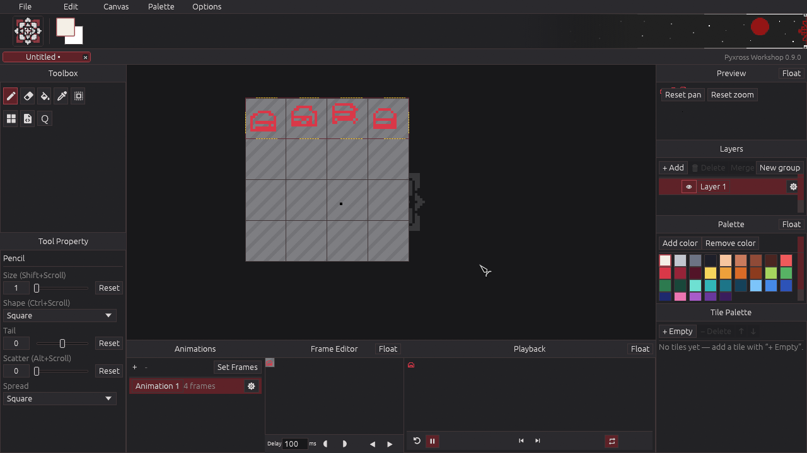

# Pyxross Workshop — User Manual

Welcome to the **Pyxross Workshop** user documentation. This guide is designed to be clear, practical, and complete — whether you are drawing your very first game sprite or building a full tileset and animation sheet.

  

---

## Table of Contents

| # | Chapter | What You Will Learn |
|---|---|---|
| 1 | [Getting Started & Core Concepts](01-getting-started.md) | Creating a new document, understanding **Regions**, workspace layout, and a quick overview of tools |
| 2 | [Toolbox, Tool Properties & All Tools](02-tools.md) | Every drawing, selection, tile, animation, and text tool with shortcuts, modifiers, and properties |
| 3 | [Layers & Layer Groups](03-layers.md) | Organizing artwork with layers, hierarchical groups, opacity, blend modes, locking, and merging |
| 4 | [Animation System](04-animations.md) | Multi-animation workflow, defining frame regions, Frame Editor, onion skinning, and live playback |
| 5 | [Tile Palette & Linked Tiles](05-tiles.md) | Reusable tiles, live instance updates, flip/rotate placement, shift-drag fill, tile eraser, and eyedropper |
| 6 | [Colors, Palettes & Color Picker](06-color-and-palette.md) | Foreground/background colors, built-in & custom palettes, and shading/lightness ramps in the Color Picker |
| 7 | [Files, Import & Export](07-files-import-export.md) | `.pyxross` projects, autosave & crash recovery, built-in File Manager, Aseprite, Pyxel Edit, PNG, GIF, and Image-to-Pixel |
| 8 | [Style & Interface Customization](08-style-and-customization.md) | Dockable & floating panels, UI style settings, custom themes, top-bar banners, keybindings, and editor options |
| 9 | [Transforms, Shortcuts & Troubleshooting](09-transforms-and-shortcuts.md) | Pixel-perfect rotation (RotSprite / CleanEdge / Rotxel), camera navigation, complete shortcut reference, and platform notes |

---

> [!TIP]
> New to Pyxross? Start with **[Chapter 1: Getting Started](01-getting-started.md)** — it explains the **Region** model that connects tiles, sprites, and animations on a single canvas.
